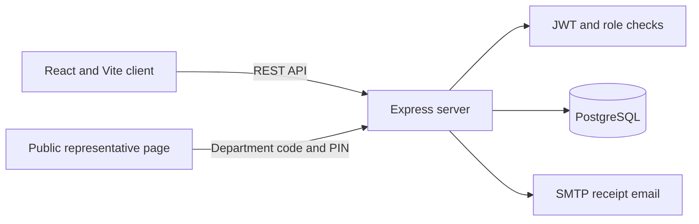
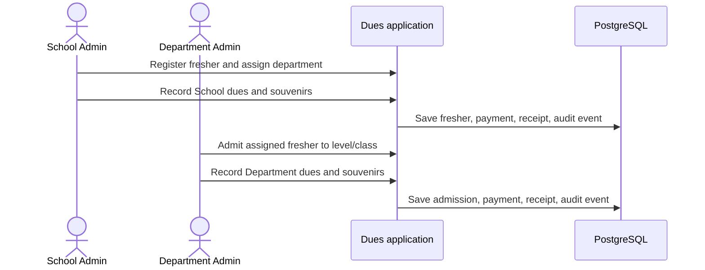
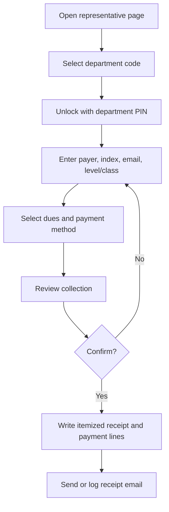

# Dues Management System Guide

## 1. Purpose and audience

The Dues Management System supports School of Sciences dues collection at the University of Energy and Natural Resources (UENR). It manages fresher registration and department admission, yearly dues collection, souvenirs, itemized receipts, verification, reports, and audit history.

This guide is for school and department administrators, class representatives, developers, and deployment operators. It describes the current v2 workflow; `PROJECT_PLAN.md` and `README.md` remain the deeper design and setup references.

## 2. User guide

### Roles

| Role | Main responsibilities |
| --- | --- |
| School Admin | Register freshers, assign departments, record School dues and souvenirs, manage school-wide settings, verify receipts, view school-wide reports and audit records. |
| Department Admin | Admit assigned freshers, configure the department's dues and souvenirs, manage its levels/classes, collect yearly dues, verify department receipts, view scoped reports. |
| Class Representative | Use the public department collection page after entering the department code and PIN; record free-flow continuing-student payments. No account is required. |

### Fresher registration and admission

1. The School Admin registers a fresher and assigns a department.
2. The School Admin records School dues and any School souvenirs issued. This creates a School receipt.
3. The fresher appears in the department's pending admission queue.
4. The Department Admin selects the student's level/class, admits the student, and records Department dues and souvenirs. This creates a separate Department receipt.

The two receipts represent separate collection events. Department Admins should only admit students assigned to their own department.

### Continuing-student collection

Continuing students are not maintained as a roster. For each collection, the Department Admin or class representative enters the payer's name, index number, email, level/class, dues being paid, amounts, and payment method. After checking the review screen, the collector confirms the payment. The receipt stores the entered payer details and itemized School and/or Department payment lines.

The class-representative flow is public and department-scoped. Representatives must use the correct department code and PIN; they should not share the PIN outside authorized collection work.

### Receipts, records, and reports

- Use **Receipts** to find issued receipts and **Verify** to validate a receipt number.
- Receipt numbers identify a collection event; a fresher can have separate registration and admission receipts.
- Use **Reports** to review date-filtered totals and export CSV where available. Results are scoped by role.
- The public `/records` page looks up payment history by index number using receipt records; it is not a student roster.
- Receipt emails are sent when SMTP is configured. Without complete SMTP configuration, the server logs the email in development mode.

### Pages at a glance

| Path | Access | Use |
| --- | --- | --- |
| `/` | Public | Enter a department code to begin representative collection. |
| `/rep/:code` | Public, PIN protected | Record a representative collection. |
| `/records` | Public | Look up receipt history by student index number. |
| `/login` | Public | Sign in to an administrator account. |
| `/admin` | Signed in | Dashboard. |
| `/admin/freshers` | Signed in, role-scoped | Register freshers or admit assigned freshers. |
| `/admin/collect` | Department Admin | Record yearly dues. |
| `/admin/receipts`, `/admin/verify` | Signed in | Browse and verify receipts. |
| `/admin/reports`, `/admin/settings` | Signed in, role-scoped | Reports and configuration. |
| `/admin/audit` | School Admin | Review transaction history. |

## 3. Technical guide

### Architecture



The frontend is in `client/`; the API and database helpers are in `server/`. PostgreSQL stores users, departments, classes, fresher records, receipts, payment lines, souvenirs, and transaction logs. Continuing-student payments are recorded on receipts and do not require a student row.

### Fresher and collection flows





### Local development

Prerequisites: Node.js 18 or newer and PostgreSQL. Configure the database and application secrets in `server/.env` using `server/.env.example` as the template. Do not copy credentials from local or production `.env` files into shared documentation.

From the project root:

```bash
npm run install:all
npm run setup
npm run dev
```

The development client is normally at `http://localhost:5173` and the API at `http://localhost:5000`. The setup command recreates the schema before seeding, so do not run it against a database containing data you need to keep.

Useful commands: `npm test`, `npm run lint`, `npm run fmt:check`. For the exact current environment variables, consult `server/.env.example`; for deployment routing and variables, consult `deployment/vultr/README.md` or the current Vercel configuration in `vercel.json` and `README.md`.

### Security and operations

- Set a unique, strong `JWT_SECRET` and production database credentials.
- Use HTTPS in production; protect SMTP credentials and department PINs.
- API authorization must remain the source of truth for school-wide and department-scoped access.
- Public representative endpoints are rate-limited and PIN-gated; monitor abuse and failed requests.
- Back up PostgreSQL before schema changes or data maintenance. Treat `backups/` as sensitive operational data.
- Avoid sharing receipts or exported reports containing student identifiers except with authorized staff.

## 4. Related project references

- `README.md` — setup, routes, deployment options, and deeper operational notes.
- `PROJECT_PLAN.md` — v2 role model, data model, and collection rules.
- `EDGE_CASES.md` — known and tested edge cases.
- `deployment/vultr/README.md` — VPS deployment instructions.