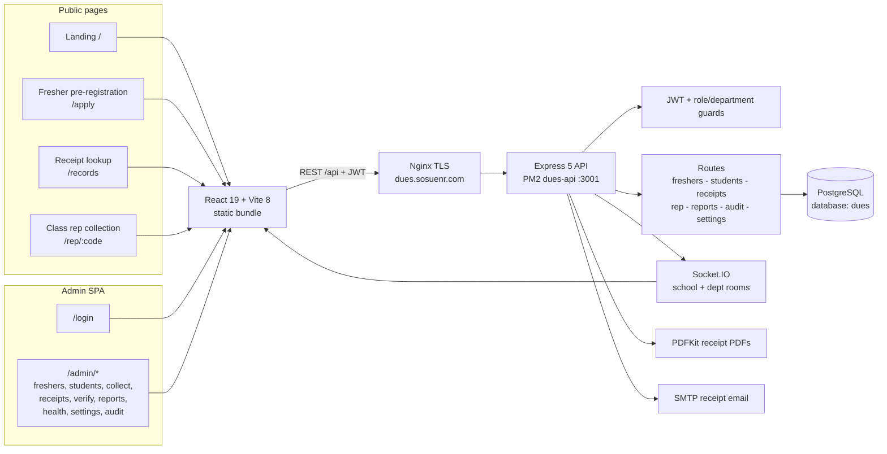
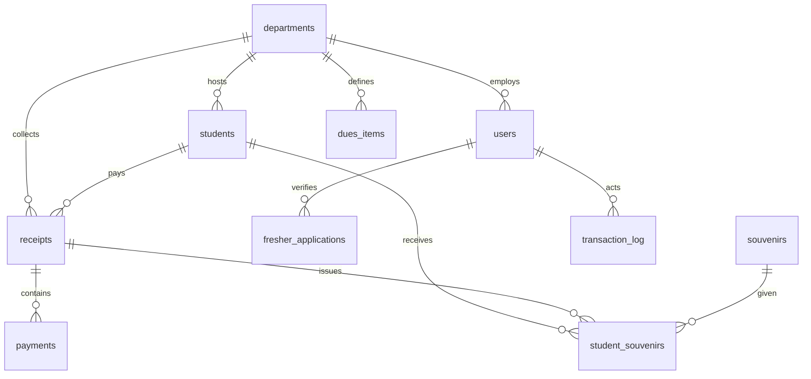
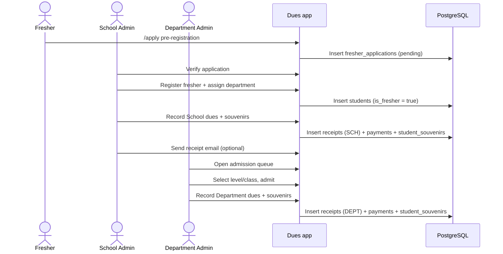
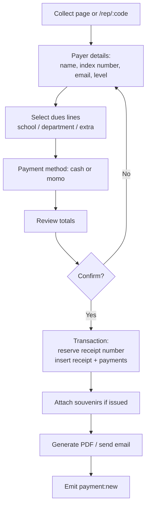

# Architecture — Dues Management

Technical reference for the School of Sciences Dues Management System.

**Diagram source:** `architecture.mmd`

Render: `npx -y @mermaid-js/mermaid-cli -i docs/architecture.mmd -o docs/architecture.pdf`



## 1. Stack and runtime

| Layer | Technology |
|---|---|
| Frontend | React 19, Vite 8, React Router 7, Axios, Socket.IO client, Phosphor Icons |
| Backend | Express 5, raw `pg` Pool (no ORM), express-validator, Helmet, express-rate-limit |
| Auth | JWT Bearer tokens, 7-day expiry |
| Realtime | Socket.IO 4, school and per-department rooms |
| Documents | PDFKit for receipt PDFs |
| Email | Nodemailer; optional, logs in development when SMTP is absent |
| Database | PostgreSQL — production `dues`, local default `dues_management` |
| Process manager | PM2 `dues-api`, fork mode, 1 instance, port 3001 |

There is **no payment gateway**. Cash and mobile-money payments are collected
offline and recorded as receipts; the system is a ledger, not a processor.

## 2. Topology

```
Browser
  │ HTTPS
  ▼
Nginx  dues.sosuenr.com
  ├── /            → /opt/dues/client/dist   (static SPA)
  ├── /api/*       → 127.0.0.1:3001          (PM2 dues-api)
  └── /socket.io/* → 127.0.0.1:3001          (WebSocket upgrade)
  │
  ▼
Express 5 API  (fork, 1 instance)
  ├── route guards + validation
  ├── PDFKit + Nodemailer
  └── pg Pool
  │
  ▼
PostgreSQL  database: dues
```

**Why fork mode:** Socket.IO connections and rooms are per-process. Running
multiple PM2 workers would split connected admins, so some clients would miss
`payment:new` and `payment:voided` events. One instance keeps every socket in
one process.

## 3. Authentication and roles

| Role | Scope |
|---|---|
| `super_admin` | Cross-school administration, including initial bootstrap |
| `school_admin` | School-wide collection, departments, users, receipts, reports, audit |
| `school_staff` | School-side operational access where granted |
| `dept_admin` | Own department: admission, dues, souvenirs, receipts, reports |
| `dept_staff` | Own department operational access where granted |

- JWTs are signed with `JWT_SECRET` and carry `id`, `role`, and
  `department_id`.
- Guards in `server/src/middleware/auth.js`: `requireAuth`,
  `requireSchoolAdmin`, `requireSchoolStaff`, department guards.
- Department scope is enforced in the API, not just by hiding UI. A department
  admin cannot read or mutate another department's records by changing an ID.
- The public class-representative flow uses a **department code + PIN**, not an
  account. PINs are stored per department, versioned (`pin_version`), and
  rate-limited.
- The initial `super_admin` is created by `db:migrate` / `db:seed` when the
  database has no super-admin. In production, leave `SUPER_ADMIN_PASSWORD`
  unset so a random password is generated once and printed to the deploy log.

## 4. API surface

Mounted in `server/src/app.js`:

| Mount | Responsibility |
|---|---|
| `/api/auth` | Login, current user, password change |
| `/api/departments` | Department records, codes, PINs |
| `/api/users` | Admin/staff accounts (school-scoped) |
| `/api/souvenirs` | School and department souvenir catalogue |
| `/api/students` | Fresher/student records, admission, transfers |
| `/api/freshers` | Public pre-registration applications and verification |
| `/api/receipts` | Collection, receipt list/detail, voiding, PDF/email, verification |
| `/api/public` | Class-rep endpoints (department code + PIN) |
| `/api/reports` | Scoped totals, breakdowns, exports |
| `/api/audit` | Transaction history (school admin) |
| `/api/settings` | School settings, dues amounts, PIN configuration |
| `/api/dues-items` | Additional named dues (“Other Dues”) |

## 5. Frontend routes

| Route | Access | Purpose |
|---|---|---|
| `/` | Public | Landing: fresher, class rep, school admin entry points |
| `/apply` | Public | Fresher pre-registration form |
| `/records` | Public | Look up payment history by index number |
| `/rep/:code` | Public + department PIN | Class-representative collection |
| `/login` | Public | Admin/staff sign-in |
| `/admin` | School/dept admin | Dashboard |
| `/admin/freshers` | Role-scoped | Register freshers (school) / admit freshers (department) |
| `/admin/students` | School admin, school staff, dept admin | Student records and rep-payment verification queue |
| `/admin/collect` | `dept_admin` | Record yearly dues |
| `/admin/receipts` | School admin, dept admin, dept staff | Browse, inspect, void, resend |
| `/admin/verify` | Any signed-in admin | Validate a receipt number |
| `/admin/reports` | School/dept admin | Scoped reports |
| `/admin/health` | School admin | Data-integrity checks |
| `/admin/settings` | School/dept admin | Dues, souvenirs, departments, PINs |
| `/admin/audit` | School admin | Transaction history |

## 6. Data model

Defined in `server/src/db/setup.js` (authoritative current schema).



| Table | Purpose |
|---|---|
| `settings` | School-wide configuration (dues amounts, current academic year) |
| `departments` | Name, code, dues amount, rep PIN, PIN version |
| `users` | Admin/staff accounts with role and optional department |
| `souvenirs` | School or department souvenir catalogue |
| `fresher_applications` | Public pre-registrations (`pending`, `verified`, `cancelled`) |
| `students` | Fresher registration/admission records only |
| `receipts` | One collection event, with payer snapshot, method, totals, void fields |
| `payments` | Itemized lines: `school_dues`, `department_dues`, `extra_dues` |
| `dues_items` | Additional named dues, school-wide or per department |
| `student_souvenirs` | Souvenirs issued, linked to a receipt |
| `transaction_log` | Audit trail of privileged actions |

Important modelling rules:

- **Continuing students have no roster row.** Their payments are free-flow: the
  payer's name, index number, email, and level are snapshotted on the receipt.
- **`students` is only the fresher lifecycle** (`is_fresher`, admission,
  verification status).
- **Levels are the only grouping axis** (100–400). There is no `classes` table.
- **Student numbers are university-issued and globally unique** (case-insensitive
  index on `student_no`).
- **Souvenirs are issued once per student per souvenir**
  (`UNIQUE(student_id, souvenir_id)`), normally at the fresher stage.
- **Voiding is non-destructive.** Receipts and payment lines keep
  `voided_at`, `voided_by`, and `void_reason` for audit.

## 7. Fresher registration and admission



- The two receipts represent **separate collection events** and are numbered
  independently.
- Department admins only see freshers assigned to their own department.
- The school-side receipt is normally `SCH`; the department-side receipt is
  normally `DEPT`. A combined collection in the continuing-student flow uses
  `FULL`.

## 8. Continuing-student collection



- Entry points: `/admin/collect` (department admin, signed in) and `/rep/:code`
  (public class rep, department code + PIN).
- The review step prevents accidental submission.
- Duplicate detection warns when a matching payment already exists.
- The whole write runs in a transaction with a per-index advisory lock, so two
  collectors cannot reserve the same sequence.

## 9. Receipts

### Numbering

Format:

```
SOS-DUES-<TAG>-<INDEX>-<n>
```

| Tag | Meaning |
|---|---|
| `SCH` | School dues only |
| `DEPT` | Department dues and/or extra dues only |
| `FULL` | School + department side combined |

- `<INDEX>` is the payer's university-issued index number (never generated).
- `<n>` is a **lifetime counter per index number**, shared across every tag and
  across student-linked and free-flow receipts.
- `pg_advisory_xact_lock(hashtext('receipt:<index>'))` serialises concurrent
  collections.
- Spent sequences are skipped while the lock is held, preventing unique
  collisions after a student is renumbered.

### Contents and delivery

- `receipts` stores the payer snapshot, method (`cash`/`momo`), level,
  academic year, recorder, department, total, and void metadata.
- `payments` stores itemized lines and snapshots `label` for `extra_dues`, so a
  renamed dues item does not rewrite history.
- PDFs are generated with PDFKit; receipt emails use SMTP when configured.
  Without SMTP, development logs the email instead of sending it.
- **Verify** validates a receipt number. **Records** looks up payment history by
  index number; it is not a student roster.
- Voiding a receipt or a single payment line keeps the row and records who
  voided it and why.

## 10. Realtime

Socket.IO authenticates with the same JWT:

| Role | Room |
|---|---|
| `school_admin` | `school` (all events) |
| `dept_admin` | `dept-<department_id>` (own department only) |
| Anonymous | Connected but receives nothing |

Events: `payment:new`, `payment:voided`, `fresher_application:new`. They drive
live dashboard/receipt refresh. Realtime is a convenience; pages re-fetch on
load, so a missed event does not corrupt state.

## 11. Reports, audit, and data health

- **Reports** are role-scoped: school-wide for school admins, department-only
  for department admins. Filters include date range and academic year; totals,
  department breakdowns, and CSV export are available.
- **Audit** (`transaction_log`) records actor, role, transaction type,
  description, metadata, and timestamp. The unrestricted view is
  school-admin-only; department admins see their own scope.
- **Data Health** (school admin) flags incomplete “Other Dues”, receipt total
  mismatches, and duplicate pre-registration numbers.

## 12. Deployment

| Item | Value |
|---|---|
| Domain | `https://dues.sosuenr.com` |
| Process | PM2 `dues-api`, fork mode, 1 instance |
| Bind | `127.0.0.1:3001` |
| Static client | `/opt/dues/client/dist`, served by Nginx |
| API proxy | `/api/*` and `/socket.io/*` → `127.0.0.1:3001` |
| Database | PostgreSQL `dues` |

The browser calls `/api` on its own origin in production, so no CORS round-trip
is needed. `CLIENT_URL` still feeds the CORS allow-list for local development
and link generation.

## 13. Configuration

| Variable | Required | Purpose |
|---|---|---|
| `DATABASE_URL` or `PGHOST`/`PGPORT`/`PGDATABASE`/`PGUSER`/`PGPASSWORD` | Yes | PostgreSQL connection |
| `PGPOOL_MAX` | No | Pool size (keep small on serverless, e.g. 5) |
| `JWT_SECRET` | Yes | Token signing; 64+ random characters in production |
| `JWT_EXPIRES_IN` | No | Token lifetime (default `7d`) |
| `CLIENT_URL` | Yes | CORS allow-list and email links |
| `SUPER_ADMIN_*` | Bootstrap only | Initial super-admin creation |
| `SMTP_*` | Optional | Receipt and notification email |
| `RECEIPT_EMAIL_TO` | Optional | Override receipt recipient |
| `PORT` | No | API port (default 5000 locally; 3001 on the shared VPS) |

## 14. Security and operations

- Keep `JWT_SECRET` unique per environment; changing it signs everyone out.
- Department PINs should be changed when a representative leaves. Use the
  settings page, which increments `pin_version`.
- Public rep endpoints are rate-limited and PIN-gated; monitor failed attempts.
- Back up PostgreSQL before schema changes or bulk maintenance. Treat
  `backups/` and exported reports as sensitive.
- Receipts, exports, and emails contain student identifiers; share only with
  authorised staff.
- `db:setup` recreates the schema — never run it against a database with data
  you need.
- Use HTTPS in production; never expose the API port publicly.
